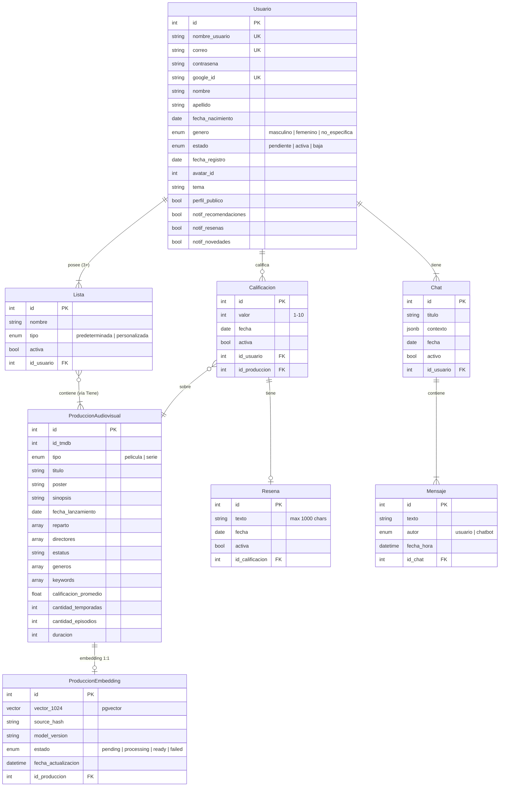

# FilmAI

**Plataforma Web de Reseñas Cinematográficas con Recomendaciones Inteligentes**

Proyecto correspondiente a la materia **Seminario Integrador** de la carrera **Analista Universitario en Sistemas de Información** (UTN-FRSF).

---

## Problemática

La sobreabundancia de contenido audiovisual disponible en plataformas de streaming genera una paradoja de elección: cuanto más material existe, más tiempo invierten los usuarios en decidir qué ver. Las recomendaciones genéricas, basadas únicamente en popularidad o en un historial de visualización superficial, rara vez capturan los matices de las preferencias individuales. A esto se suma la ausencia de un espacio personal donde cada usuario pueda gestionar su recorrido cinematográfico de forma integral: explorar opciones, organizar listas, consultar detalles de películas y series, y registrar opiniones o reseñas en un solo lugar.

FilmAI aborda esta problemática combinando un catálogo actualizado de películas y series con herramientas de gestión personal y un motor de recomendación inteligente. El sistema ofrece un entorno donde cada usuario puede desarrollar su perfil cinematográfico —explorando el catálogo, creando listas temáticas, calificando producciones y escribiendo reseñas— mientras recibe sugerencias contextuales a través de un chatbot basado en inteligencia artificial que analiza su historial, calificaciones y preferencias reales, en lugar de depender únicamente del razonamiento genérico de un modelo de lenguaje.

---

## Objetivos

### Objetivo general

Desarrollar una aplicación web integral que permita gestionar, calificar y explorar películas y series, integrando un chatbot basado en IA para mejorar la experiencia del usuario en base a consultas que este puede realizarle.

### Objetivos específicos

- Implementar un sistema completo de registro, autenticación y gestión de perfiles de usuario.
- Integrar el sistema con The Movie Database (TMDB) para mantener un catálogo actualizado con información detallada de cada producción.
- Desarrollar un sistema de calificación por estrellas (escala 1 a 10), reseñas textuales y listas personalizadas (favoritos, pendientes, vistas y listas definidas por el usuario).
- Implementar un chatbot basado en modelos de lenguaje (LLM) que analice preferencias, historial y perfil del usuario para generar recomendaciones contextuales.

---

## Funcionalidades principales

### Catálogo y descubrimiento

- Catálogo unificado de películas y series sincronizado con TMDB.
- Página de inicio con filas de descubrimiento: recomendaciones personalizadas, tendencias semanales y novedades.
- Búsqueda por texto con filtros por tipo (película/serie), género, año y calificación mínima.
- Ficha de detalle con sinopsis, reparto, géneros y calificación promedio de la comunidad.

### Reseñas y calificaciones

- Calificación en escala numérica de 1 a 10 con widget interactivo de estrellas.
- Reseñas textuales opcionales (hasta 1000 caracteres) asociadas a cada calificación.
- Edición y eliminación de reseñas propias desde la ficha de detalle o desde la sección "Mis reseñas".

### Listas personalizadas

- Tres listas predeterminadas por usuario: Favoritos, Pendientes y Vistas.
- Listas personalizadas con nombres definidos por el usuario, reordenables y gestionables mediante modales dedicados.
- Acciones directas desde la ficha de detalle: agregar o quitar una producción de cualquier lista.

### Chatbot inteligente

- Accesible desde un botón flotante (FAB) en todas las pantallas de la aplicación.
- Procesa consultas en lenguaje natural y genera recomendaciones basadas en el historial, calificaciones y preferencias del usuario.
- Los datos sensibles (email, nombre, apellido) se anonimizan antes de ser enviados al proveedor del LLM.
- Soporte para cancelación de solicitudes en curso.

### Perfil y preferencias

- Edición inline del perfil: nombre, apellido, nombre de usuario, avatar y contraseña.
- Selección de avatar desde una galería de 20 opciones predefinidas.
- Configuración de tema (oscuro por defecto, con opción clara), privacidad del perfil y preferencias de notificaciones.
- Baja de cuenta con eliminación lógica (soft delete).

---

## Arquitectura y tecnologías

### Stack tecnológico

| Capa                  | Tecnología                                                                 |
| --------------------- | -------------------------------------------------------------------------- |
| **Backend**           | Python 3.12, Django 5.x, Django REST Framework                             |
| **Frontend**          | Next.js 15 (App Router), Tailwind CSS v4, Shadcn/ui                        |
| **Base de datos**     | PostgreSQL 16 con pgvector (imagen `pgvector/pgvector:pg16`)               |
| **Caché y colas**     | Redis (DB 0: caché de TMDB · DB 1: broker de Celery · DB 2: resultados)    |
| **Tareas asíncronas** | Celery (worker activo; Celery Beat para la sync programada, pendiente)     |
| **Embeddings (en curso)** | pgvector sobre PostgreSQL + Ollama (BGE-M3), generación asíncrona vía Celery. El proveedor real de embeddings todavía es un stub (llega en B-06). |
| **Infraestructura**   | Docker, docker-compose (5 servicios: backend, frontend, PostgreSQL, Redis, celery-worker) |
| **Autenticación**     | JWT (access + refresh tokens, sesión de 8 horas), Google OAuth 2.0, bcrypt |

### APIs externas

| Proveedor                               | Propósito                                                            |
| --------------------------------------- | -------------------------------------------------------------------- |
| **TMDB API**                            | Catálogo de películas y series, búsqueda, tendencias, metadatos      |
| **LLM API** | Procesamiento de lenguaje natural para el chatbot de recomendaciones |

### Modelo de datos

El dominio se compone de las siguientes entidades principales y sus relaciones:



**Descripción de las entidades:**

- **Usuario**: entidad única de identidad y preferencias. Rol administrador gestionado vía flags `is_staff`/`is_superuser` del Django Admin nativo.
- **ProducciónAudiovisual**: entidad unificada para películas y series, diferenciadas por un atributo `tipo`. Catálogo global materializado progresivamente desde TMDB.
- **Calificación**: valor numérico (1-10) emitido por un usuario sobre una producción. Restricción de unicidad por par (usuario, producción).
- **Reseña**: texto opcional vinculado uno a uno con una calificación.
- **Lista**: colecciones de producciones (predeterminadas o personalizadas) asociadas a un usuario. La tabla intermedia **Tiene** registra la fecha de agregado.
- **Chat**: conversación asociada a un usuario, con contexto persistente en formato JSONB.
- **Mensaje**: unidad de diálogo dentro de un chat, con indicación de autor (usuario o chatbot).
- **ProducciónEmbedding** *(planificada)*: relación 1:1 con `ProducciónAudiovisual` + vector pgvector(1024) + índice HNSW. Generación asíncrona vía Celery. Alimenta la búsqueda semántica del chatbot.

---

## Ejecución del proyecto

### Arranque rápido (cada vez)

```bash
docker compose up --build   # primera vez, o tras cambios en los Dockerfiles
docker compose up           # levantamiento rápido sin rebuild
docker compose down         # detener (conserva la base de datos y Redis)
```

### URLs

| Servicio           | URL                                |
| ------------------ | ---------------------------------- |
| Frontend (Next.js) | http://localhost:3000              |
| Backend (Django)   | http://localhost:8000              |
| Admin de Django    | http://localhost:8000/admin/       |
| PostgreSQL         | `localhost:5432` (db `filmai_dev`) |
| Redis              | `localhost:6379`                   |

### Comandos útiles

```bash
docker compose ps                     # estado de los 5 servicios
docker compose logs -f celery-worker  # seguir los logs del worker de Celery
docker compose restart celery-worker  # solo si el auto-reload falla (ver nota abajo)
docker compose logs -f backend  # seguir los logs de Django
docker compose logs -f frontend # seguir los logs de Next.js
docker compose down -v          # detener y borrar BD + Redis (datos)
```

> **⚠️ Si editás una tarea de Celery y el worker no se reinició, sigue
> corriendo la versión vieja sin avisarte.** No hay error, no hay log: el
> código que ves en el editor y el que ejecuta el worker son distintos.
>
> Agregar o renombrar una tarea sí avisa (el worker rechaza el mensaje con
> `KeyError: 'catalogo.generar_embedding'`). **Editar el cuerpo de una tarea
> existente no avisa nada.** Ese es el caso que hace perder horas.

Celery, a diferencia del `runserver` de Django, no recarga código por su
cuenta. Por eso el servicio `celery-worker` corre envuelto en
`watchmedo auto-restart`, que lo reinicia al guardar cualquier `.py`. Si
alguna vez el auto-reload no se dispara, reiniciá el worker a mano con
`docker compose restart celery-worker`.

### Configuración inicial (solo la primera vez)

1. **Crear el `.env`** desde la plantilla y completar las variables obligatorias:

   ```bash
   cp .env.example .env
   ```

   - `SECRET_KEY`: generar con `python -c "from django.core.management.utils import get_random_secret_key; print(get_random_secret_key())"`.
   - `POSTGRES_PASSWORD` y `DJANGO_SUPERUSER_PASSWORD`: contraseñas de desarrollo.
   - Las claves externas (`TMDB_API_KEY`, `GOOGLE_CLIENT_ID`, `LLM_API_KEY`) pueden quedar vacías hasta que se implementen esos módulos.

### Credenciales de desarrollo

El backend crea automáticamente un superusuario al arrancar, usando las variables `DJANGO_SUPERUSER_USERNAME`, `DJANGO_SUPERUSER_EMAIL` y `DJANGO_SUPERUSER_PASSWORD` del `.env`. Entrar a `/admin/` con esos datos y cambiar la contraseña tras el primer acceso.

#### Cuentas de prueba

El comando `seed` crea tres cuentas de desarrollo con el email verificado y la misma contraseña:

| Email | Contraseña |
| --- | --- |
| `usuario001@filmai.com` | `Password123!` |
| `usuario002@filmai.com` | `Password123!` |
| `usuario003@filmai.com` | `Password123!` |

Para recrear los datos de desarrollo:

```bash
docker compose exec backend python manage.py seed
```

> **Advertencia:** `seed` es destructivo para los datos de las aplicaciones de negocio: elimina y recrea usuarios de prueba, catálogo, listas, reseñas, calificaciones y chats. No elimina el superusuario creado por el entrypoint.

Para verificar el envío de emails usando el backend configurado:

```bash
docker compose exec backend python manage.py send_test_email
```

En desarrollo, `RESEND_TEST_RECIPIENT` puede redirigir el envío al destinatario de prueba configurado en `.env`.

---

## Accesibilidad

FilmAI se desarrolla siguiendo los principios **POUR** de las **WCAG 2.1** con nivel de conformidad **AA**:

- **Perceptible (Perceivable):** la información y los componentes de la interfaz se presentan de forma que los usuarios puedan percibirlos. Contraste mínimo de 4.5:1 para texto normal y 3:1 para texto grande. Textos alternativos en imágenes informativas. Estructura jerárquica de encabezados sin saltos de nivel.
- **Operable (Operable):** los componentes de la interfaz y la navegación se operan completamente mediante teclado. Indicador de foco visible en todos los elementos interactivos. Alternativas accesibles para drag and drop (botones "Mover arriba" / "Mover abajo"). Tecla Escape para cerrar modales.
- **Comprensible (Understandable):** los formularios incluyen etiquetas asociadas, mensajes de error descriptivos vinculados mediante `aria-describedby` y validación inline. El contenido permanece legible con zoom del 200%.
- **Robusto (Robust):** se utilizan roles ARIA apropiados (`role="switch"`, `role="alert"`, `aria-live`) para garantizar compatibilidad con lectores de pantalla y tecnologías de asistencia.

Referencia de verificación: [WebAIM WCAG 2 Checklist](https://webaim.org/standards/wcag/checklist).

---

## Documentación relacionada

| Documento                                                                                     | Contenido                                                 |
| --------------------------------------------------------------------------------------------- | --------------------------------------------------------- |
| [`01_Presentación Idea-Proyecto`](docs/01_Presentaci%C3%B3n%20Idea-Proyecto.docx.md)          | Propuesta inicial, problemática y objetivos               |
| [`02_Especificación de Requerimientos`](docs/02_Especificaci%C3%B3n%20de%20Requerimientos.md) | Requerimientos funcionales, no funcionales y casos de uso |
| [`03_Modelos de Datos y de Diseño`](docs/03_Modelos%20de%20Datos%20y%20de%20Dise%C3%B1o.md)   | Diagrama de clases y modelo relacional                    |
| [`04_Lineamientos UI`](docs/04_Lineamientos_UI.md)                                            | Diseño de interfaces, componentes y accesibilidad         |
| [`05_Plan de Desarrollo`](docs/05_Plan_de_Desarrollo.md)                                      | Plan de trabajo, módulos y estimaciones                   |
| [`06_TMDB API Referencia`](docs/06_TMDB_API_Referencia.md)                                    | Referencia técnica de la API de TMDB                      |