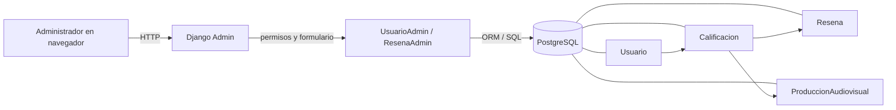

# Módulo 6: administración y moderación en Django Admin

## 1. Alcance

AD-01' usa el panel nativo de Django en `/admin/`. `UsuarioAdmin` ya existía y se conserva. Este módulo agrega `ResenaAdmin` para revisar reseñas, corregir su texto y desactivarlas. No introduce endpoints REST ni una pantalla propia. Los datos creados por los tests viven en la base temporal que Django prepara para cada ejecución; no se sembró la base de desarrollo.

Una reseña depende de una calificación, y esa calificación vincula al usuario con la producción. La moderación conserva esas relaciones: desactivar establece `activa=False` en la reseña, sin borrar su fila ni modificar la calificación.



`ModelAdmin` es la clase con la que Django configura las páginas de un modelo en el panel. El ORM es la capa de Django que convierte operaciones sobre objetos y consultas en SQL. El diagrama muestra las relaciones; los tests no llaman a TMDB ni a Celery.

## 2. Gestión de usuarios que ya existía

`UsuarioAdmin` hereda de `UserAdmin`, la configuración que Django ofrece para cuentas y permisos. Sus campos están adaptados a `usuarios.Usuario`: permite buscar por correo, nombre de usuario, nombre y apellido, y filtrar por estado o privilegios. El formulario también expone el estado de la cuenta y los permisos. Se verificaron por HTTP la edición, el cambio a `baja` y el borrado de un usuario de prueba.

Ruta: `backend/usuarios/admin.py`. Este fragmento no se modificó en AD-01'.

```python
@admin.register(Usuario)
class UsuarioAdmin(BaseUserAdmin):
    """Admin para el modelo personalizado de usuario.

    Adapta `UserAdmin` de Django a los campos de `usuarios.Usuario`
    (correo, nombre_usuario, nombre, apellido, etc.) en lugar de los
    campos por defecto de `auth.User`.
    """

    # --- Listado ---
    list_display = (
        "correo",
        "nombre_usuario",
        "nombre",
        "apellido",
        "estado",
        "is_staff",
    )
    list_filter = ("estado", "is_staff", "is_superuser", "genero")
    search_fields = ("correo", "nombre_usuario", "nombre", "apellido")
    ordering = ("correo",)
```

## 3. Listado, búsqueda y filtros de reseñas

`@admin.register(Resena)` incorpora el modelo al panel. `list_display` define las columnas; `search_fields` y `list_filter` configuran las búsquedas y los filtros que aparecen en la página. Las rutas con doble guion bajo, como `calificacion__produccion__titulo`, atraviesan relaciones del modelo en una consulta SQL. El listado incluye tanto las reseñas activas como las desactivadas.

Ruta: `backend/catalogo/admin.py`.

```python
@admin.register(Resena)
class ResenaAdmin(admin.ModelAdmin):
    list_display = ("id", "usuario", "produccion", "tipo", "valor", "activa", "fecha")
    list_filter = ("activa", "calificacion__produccion__tipo")
    search_fields = (
        "texto",
        "calificacion__usuario__correo",
        "calificacion__usuario__nombre_usuario",
        "calificacion__produccion__titulo",
    )
    fields = ("calificacion", "texto", "activa", "fecha")
    readonly_fields = ("calificacion", "fecha")
    actions = ("desactivar_resenas",)
```

El Admin carga usuario y producción junto con la reseña. `select_related` resuelve relaciones de clave foránea mediante joins SQL y evita una consulta adicional por cada fila del listado. Los métodos decorados con `@admin.display` aportan valores y etiquetas a las columnas.

```python
    def get_queryset(self, request):
        return (
            super()
            .get_queryset(request)
            .select_related("calificacion__usuario", "calificacion__produccion")
        )

    @admin.display(
        description="Usuario", ordering="calificacion__usuario__nombre_usuario"
    )
    def usuario(self, obj):
        return obj.calificacion.usuario
```

## 4. Edición y borrado lógico

El formulario deja `calificacion` en solo lectura. Aunque alguien envíe otro identificador en un POST manipulado, el Admin no lo toma como campo editable. `fecha` también queda fija. Sí se pueden cambiar `texto` y `activa`, de modo que un moderador puede reactivar una reseña desactivada.

La acción trabaja con un `queryset`, es decir, el conjunto de reseñas seleccionadas en el listado. `update` cambia solo el indicador `activa` en la base. El permiso `change` es necesario para ofrecer y ejecutar la acción. `has_add_permission` y `has_delete_permission` deshabilitan el alta y el borrado físico, incluido el borrado masivo que Django ofrece por defecto.

Ruta: `backend/catalogo/admin.py`.

```python
    @admin.action(description="Desactivar reseñas", permissions=["change"])
    def desactivar_resenas(self, request, queryset):
        cantidad = queryset.update(activa=False)
        self.message_user(request, f"{cantidad} reseña(s) desactivada(s).")

    def has_add_permission(self, request):
        return False

    def has_delete_permission(self, request, obj=None):
        return False
```

Esto implementa CU-017 para el moderador. La gestión de la propia reseña por parte del usuario corresponde a CU-015 y conserva su contrato separado.

## 5. Permisos

Para entrar al panel, la cuenta debe ser de `staff` y estar activa. Después, Django comprueba permisos por modelo. Un miembro de `staff` sin permiso de `Resena` recibe 403; con `view_resena` puede leer; con `change_resena` puede editar y usar la acción. Un usuario común y un visitante son redirigidos al acceso del Admin. El superusuario usado en los tests tiene los permisos necesarios para comprobar todas las operaciones.

No se agregó un rol paralelo: el modelo `Usuario` ya representa al administrador mediante `is_staff`, `is_superuser` y los permisos de Django.

## 6. Pruebas HTTP

Los tests están en `backend/catalogo/test_admin.py`. `TestCase` crea una base temporal, ejecuta cada test dentro de una transacción aislada y descarta los datos al terminar. `setUpTestData` prepara las relaciones una vez por clase. `self.client` solicita las páginas y envía formularios reales del Admin; `force_login` crea una sesión de prueba sin pasar por el formulario de acceso.

El fixture crea dos cadenas completas `Usuario → Calificacion → Resena` vinculadas a una película y una serie. Una reseña comienza desactivada para comprobar que sigue apareciendo en el listado. El fragmento siguiente es literal.

```python
        cls.calificacion = Calificacion.objects.create(
            usuario=cls.autor, produccion=pelicula, valor=8
        )
        otra_calificacion = Calificacion.objects.create(
            usuario=cls.otro_autor, produccion=serie, valor=4
        )
        cls.resena = Resena.objects.create(
            calificacion=cls.calificacion, texto="Texto especial alfa"
        )
        cls.otra_resena = Resena.objects.create(
            calificacion=otra_calificacion, texto="Texto beta", activa=False
        )
```

La prueba de la acción envía el mismo POST que el formulario del listado. Después consulta la base para comprobar que la reseña quedó inactiva y que la calificación permanece. También busca la reseña bajo el filtro de inactivas y la reactiva mediante el formulario de edición.

```python
        respuesta = self.client.post(
            self.lista_url,
            {"action": "desactivar_resenas", "_selected_action": [self.resena.pk]},
        )
        self.assertEqual(respuesta.status_code, 302)
        self.resena.refresh_from_db()
        self.assertFalse(self.resena.activa)
        self.assertTrue(Calificacion.objects.filter(pk=self.calificacion.pk).exists())
```

| Prueba                       | Qué protege                                                                                       |
| ---------------------------- | ------------------------------------------------------------------------------------------------- |
| Listado y relaciones         | Muestra usuario, producción, valor y reseñas inactivas.                                           |
| Búsqueda de reseñas          | Encuentra por texto, nombre de usuario, correo y título.                                          |
| Filtros de reseñas           | Separa activas/inactivas y película/serie.                                                        |
| Edición de reseña            | Cambia texto y estado sin aceptar una calificación enviada en el POST.                            |
| Acción y reactivación        | Desactiva, conserva fila y calificación, y permite volver a activar.                              |
| Alta y borrado de reseñas    | Las rutas de alta y borrado individual responden 403; un POST de borrado masivo no elimina filas. |
| Permisos de reseña           | Distingue visitante, usuario común, staff sin permisos, lectura y cambio.                         |
| Búsqueda y filtro de usuario | Comprueba que `UsuarioAdmin` encuentra y filtra cuentas.                                          |
| Edición y borrado de usuario | Comprueba el cambio a `baja` y el borrado físico de una cuenta de prueba.                         |
| Permisos de usuario          | Impide operar a visitantes, usuarios comunes y staff sin permiso de lectura o cambio.             |

## 7. Verificaciones y referencia de integración

| Control                                               | Resultado                      |
| ----------------------------------------------------- | ------------------------------ |
| `python manage.py test catalogo.test_admin --noinput` | 10 tests, OK.                  |
| `python manage.py test --noinput`                     | 273 tests, OK.                 |
| `ruff format .` y `ruff check .`                      | Formato aplicado; lint limpio. |
| `npx prettier --check .` en frontend                  | Limpio.                        |
| Merge de prueba con `git merge-tree`                  | Sin conflictos.                |

Se obtuvo `origin/main` antes de la comprobación: `a0268ea1ffa79ec25eb860a7bc3450ccff008ce6`. El merge se calculó con una instantánea temporal de los cambios y no modificó la rama. Se repitió sobre el árbol final, incluido este documento, antes del cierre. No se realizó el merge.

## 8. Glosario breve

| Concepto          | Significado en este módulo                                                                 |
| ----------------- | ------------------------------------------------------------------------------------------ |
| Django Admin      | Panel que Django genera para administrar modelos registrados.                              |
| `ModelAdmin`      | Clase que define columnas, búsquedas, filtros, formularios, acciones y permisos del panel. |
| ORM               | Capa que expresa consultas y cambios sobre modelos Python y los traduce a SQL.             |
| `QuerySet`        | Conjunto consultable de filas de un modelo; aquí contiene las reseñas seleccionadas.       |
| `select_related`  | Carga relaciones de clave foránea con joins en la misma consulta.                          |
| `readonly_fields` | Campos visibles en el formulario que el Admin no acepta como editables.                    |
| Borrado lógico    | Conserva la fila y cambia un indicador de estado; aquí, `activa=False`.                    |
| `TestCase`        | Clase de Django que ejecuta tests con datos aislados en una base de prueba.                |
