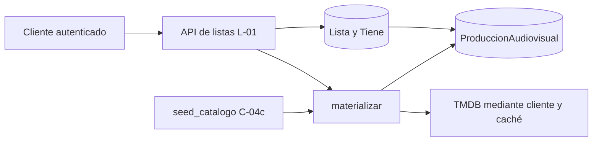

# Implementación de listas y catálogo en los PR #27, #28 y #29

## 1. Introducción

El plan de desarrollo separa estas entregas en dos momentos. L-01, implementado por el PR #27, pertenece a la fase 2 y expone la API con la que se administran listas. C-04c pertenece a la fase 3 y se dividió entre el PR #28, que preparó el acceso a TMDB, y el PR #29, que construyó el proceso de carga inicial del catálogo.

La relación entre ambos módulos aparece cuando se agrega una producción a una lista. La API recibe una identidad externa de TMDB, pero la relación `Tiene` necesita una fila local de `ProduccionAudiovisual`. Por eso L-01 llama al servicio de materialización del catálogo antes de crear el ítem. El seed de C-04c amplía ese mismo catálogo sin abrir un segundo camino de escritura.



Los fragmentos siguientes corresponden al estado final de `main` después de integrar los tres PR. El contenido de las sentencias no se reescribe. Algunos bloques se dedentan cuando se omite la clase o función envolvente; esa adaptación de sangría y el marcador `# ...`, que señala código contiguo omitido, son las únicas modificaciones editoriales.

## 2. PR #27: endpoints de listas, fase L-01

### 2.1. Modelo relacional e invariantes en la base de datos

La relación entre listas y producciones es de muchos a muchos y contiene un dato propio, `fecha_agregado`. Por ese motivo se usa el modelo intermedio `Tiene` en lugar de una relación implícita. La base también protege dos invariantes: una producción no puede repetirse dentro de la misma lista y un usuario no puede tener dos listas cuyos nombres solo difieran por mayúsculas.

- El modelo intermedio conserva el momento de incorporación del contenido.
- La unicidad compuesta impide duplicados incluso ante solicitudes concurrentes.
- `Lower("nombre")` traslada la unicidad sin distinción de mayúsculas a PostgreSQL.
- La protección en la base complementa la validación de la API y evita depender de un único punto de entrada.

Ruta: `backend/listas/models.py`. Origen: PR #27 para la restricción funcional; el modelo `Tiene` ya formaba parte de la base del módulo.

```python
class Meta:
    db_table = "lista"
    verbose_name = "lista"
    verbose_name_plural = "listas"
    ordering = ["id"]
    constraints = [
        # El nombre de lista es único por usuario sin distinguir
        # mayúsculas/minúsculas (CU-012).
        models.UniqueConstraint(
            Lower("nombre"),
            "usuario",
            name="uq_lista_usuario_nombre",
        ),
    ]
```

### 2.2. Migración de una regla existente

Cambiar una restricción del modelo no modifica por sí solo una base ya creada. La migración elimina la restricción sensible a mayúsculas y crea otra con el mismo nombre sobre la expresión `Lower("nombre")`. Esto mantiene alineados el estado declarado por Django y el esquema real.

- La dependencia `0002_initial` fija el orden de aplicación.
- La operación es explícita y reproducible en cualquier entorno.
- No se altera la tabla completa ni se introduce un modelo paralelo.

Ruta: `backend/listas/migrations/0003_lista_nombre_case_insensitive.py`. Origen: PR #27.

```python
operations = [
    migrations.RemoveConstraint(
        model_name="lista",
        name="uq_lista_usuario_nombre",
    ),
    migrations.AddConstraint(
        model_name="lista",
        constraint=models.UniqueConstraint(
            Lower("nombre"),
            "usuario",
            name="uq_lista_usuario_nombre",
        ),
    ),
]
```

### 2.3. Validación y normalización en el límite HTTP

El serializer convierte espacios consecutivos en uno solo y valida el alfabeto admitido antes de tocar la base. Esta normalización evita que nombres visualmente equivalentes se almacenen con diferencias accidentales. La consulta previa mejora el mensaje de error, mientras que la restricción de base conserva la garantía ante carreras.

- Se aceptan letras Unicode, números y espacios.
- El máximo de 80 caracteres se aplica después de normalizar.
- La búsqueda `iexact` detecta duplicados sin distinguir mayúsculas.
- Al renombrar se excluye la propia lista de la comprobación.

Ruta: `backend/listas/serializers.py`. Origen: PR #27.

```python
def validate_nombre(self, value):
    nombre = " ".join(value.split())
    if not nombre:
        raise serializers.ValidationError("El nombre no puede estar vacío.")
    if len(nombre) > 80:
        raise serializers.ValidationError(
            "El nombre no puede superar los 80 caracteres."
        )
    if not any(caracter.isalnum() for caracter in nombre):
        raise serializers.ValidationError(
            "El nombre debe incluir al menos una letra o número."
        )
    if any(not (caracter.isalnum() or caracter == " ") for caracter in nombre):
        raise serializers.ValidationError(
            "Solo se permiten letras, números y espacios."
        )

    usuario = self.context["request"].user
    lista_id = self.context.get("lista_id")
    existentes = Lista.objects.filter(usuario=usuario, nombre__iexact=nombre)
    if lista_id is not None:
        existentes = existentes.exclude(pk=lista_id)
    # ...
```

### 2.4. Autorización por propiedad y ocultamiento de recursos ajenos

La autenticación global de DRF exige una sesión válida y cada búsqueda de detalle incorpora al usuario en el filtro. Este patrón aplica autorización a nivel de objeto: conocer el identificador de una lista ajena no permite leerla ni modificarla. La respuesta `404` tampoco confirma que el recurso exista.

- Solo se consideran listas activas del usuario autenticado.
- El mismo helper se reutiliza para detalle, ítems y borrado.
- El filtrado previo evita comprobaciones dispersas después de cargar el objeto.

Ruta: `backend/listas/views.py`. Origen: PR #27.

```python
def _lista_propia(request, lista_id):
    return get_object_or_404(
        Lista.objects.filter(usuario=request.user, activa=True), pk=lista_id
    )


def _proteger_lista_predeterminada(lista):
    if lista.tipo == TipoLista.PREDETERMINADA:
        raise ListaPredeterminadaProtegida
```

### 2.5. Modelo de lectura para las tarjetas de listas

El endpoint general devuelve un resumen preparado para la futura `ListCard`: totales, desglose por tipo y pertenencia opcional. Las agregaciones se ejecutan en la base, donde resulta más barato contar que cargar todos los ítems en Python. `Exists` responde si una producción pertenece a cada lista y `Subquery` obtiene el identificador necesario para quitarla después.

- Las listas predeterminadas conservan el orden Favoritos, Pendientes y Vistas.
- Los contadores se calculan sin serializar todas las relaciones.
- La consulta de pertenencia solo se añade cuando llegan ambos datos de TMDB.
- La respuesta sirve tanto para la vista general como para un selector con checkboxes.

Ruta: `backend/listas/views.py`. Origen: PR #27.

```python
listas = (
    Lista.objects.filter(usuario=request.user, activa=True)
    .annotate(
        cantidad_items=Count("items"),
        cantidad_peliculas=Count(
            "items", filter=Q(items__produccion__tipo=TipoProduccion.PELICULA)
        ),
        cantidad_series=Count(
            "items", filter=Q(items__produccion__tipo=TipoProduccion.SERIE)
        ),
    )
    .annotate(orden_predeterminada=_ORDEN_PREDETERMINADAS)
    .order_by("orden_predeterminada", "id")
)

if pertenencia is not None:
    id_tmdb, tipo = pertenencia
    item = Tiene.objects.filter(
        lista_id=OuterRef("pk"),
        produccion__id_tmdb=id_tmdb,
        produccion__tipo=tipo,
    )
    listas = listas.annotate(
        contiene=Exists(item), item_id=Subquery(item.values("pk")[:1])
    )
```

### 2.6. Preview limitado y paginación estable

Los pósters del resumen se limitan por lista mediante una función de ventana. `RowNumber` numera los ítems dentro de cada partición y permite conservar solo los cinco más recientes. En el detalle se usa paginación por cursor, que es más estable que el desplazamiento numérico cuando se agregan contenidos mientras se navega.

- El límite de cinco pertenece al contrato visual de la tarjeta.
- El desempate por identificador vuelve determinista el orden.
- El cursor entrega veinte resultados ordenados desde el agregado más reciente.
- El enfoque evita cargar la colección completa para recortarla en memoria.

Ruta: `backend/listas/views.py`. Origen: PR #27.

```python
previews = (
    Tiene.objects.filter(
        lista_id__in=[lista.pk for lista in listas], produccion__poster__gt=""
    )
    .select_related("produccion")
    .annotate(
        posicion=Window(
            expression=RowNumber(),
            partition_by=[F("lista_id")],
            order_by=[F("fecha_agregado").desc(), F("id").desc()],
        )
    )
    .filter(posicion__lte=_MAX_PREVIEW_POSTERS)
    .order_by("lista_id", "posicion")
)
```

### 2.7. Reglas de negocio expresadas como conflictos HTTP

Las listas predeterminadas no pueden renombrarse ni eliminarse. Además, una producción con calificación activa no puede quitarse de Vistas, porque esa lista representa el historial que respalda la calificación. Estas condiciones no se dejan solo en la interfaz: la API las impone y devuelve conflictos `409` con códigos estables.

- La regla permanece vigente para cualquier cliente de la API.
- El código estable permite que el frontend distinga el motivo sin analizar texto.
- La consulta se restringe al usuario, la producción y las calificaciones activas.

Ruta: `backend/listas/views.py`. Origen: PR #27.

```python
if (
    lista.tipo == TipoLista.PREDETERMINADA
    and lista.nombre == "Vistas"
    and Calificacion.objects.filter(
        usuario=request.user, produccion=item.produccion, activa=True
    ).exists()
):
    raise CalificacionImpideQuitarDeVistas
item.delete()
return Response(status=status.HTTP_204_NO_CONTENT)
```

### 2.8. Pruebas del contrato observable

Las pruebas usan el cliente HTTP de DRF y verifican respuestas completas, no solo helpers internos. El caso de materialización confirma la frontera entre módulos: primero se obtiene una producción local y luego se crea `Tiene` con su fecha.

- Se cubren autenticación, propiedad, CRUD, duplicados y listas predeterminadas.
- Se verifican contadores, previews, pertenencia y paginación.
- Se comprueba la restricción de Vistas con una calificación activa.
- El mock aísla la API de listas sin reemplazar su contrato con catálogo.

Ruta: `backend/listas/tests.py`. Origen: PR #27.

```python
@patch("listas.views.materializar")
def test_agregar_item_materializa_y_registra_fecha(self, materializar_mock):
    """Toda relación apunta a una producción local materializada primero."""
    lista = self._lista_personalizada()
    produccion = self._produccion()
    materializar_mock.return_value = produccion

    respuesta = self.cliente.post(
        f"/api/lists/{lista.pk}/items/",
        {"id_tmdb": 550, "tipo": "movie"},
        format="json",
    )

    self.assertEqual(respuesta.status_code, 201)
    materializar_mock.assert_called_once_with(550, "movie")
    item = Tiene.objects.get(lista=lista, produccion=produccion)
    self.assertIsNotNone(item.fecha_agregado)
    self.assertEqual(respuesta.data["item_id"], item.pk)
```

L-01 no incorpora componentes de frontend de producción. Las pantallas y acciones visuales siguen planificadas en L-02, L-03 y L-04. El cambio en `docs/wireframes/Opcion 1/app.html` documenta el contrato visual, pero no sustituye esas fases.

## 3. PR #28: cliente y caché para C-04c, fase 1

### 3.1. Extensión compatible del cliente de TMDB

El seed necesita recorrer décadas y ordenar por cantidad de votos. TMDB usa nombres distintos para las fechas de películas y series, por lo que el cliente traduce el tipo al parámetro correcto. Los argumentos nuevos son opcionales y preservan el comportamiento de los consumidores anteriores.

- Las películas usan `primary_release_date` y las series `first_air_date`.
- Los límites se convierten en fechas completas para cubrir toda la década.
- `sort_by` se envía solo cuando fue solicitado.
- La firma anterior sigue siendo válida porque los parámetros se agregan al final.

Ruta: `backend/catalogo/client.py`. Origen: PR #28.

```python
params = {"page": page}
if genero is not None:
    params["with_genres"] = genero
if anio is not None:
    params[_DISCOVER_YEAR_PARAM[tipo]] = anio
if anio_desde is not None:
    params[f"{_DISCOVER_DATE_PARAM[tipo]}.gte"] = f"{anio_desde}-01-01"
if anio_hasta is not None:
    params[f"{_DISCOVER_DATE_PARAM[tipo]}.lte"] = f"{anio_hasta}-12-31"
if min_rating is not None:
    params["vote_average.gte"] = min_rating
if sort_by is not None:
    params["sort_by"] = sort_by
return self._get(f"/discover/{tipo}", params)
```

### 3.2. Géneros obtenidos desde la fuente externa

Los identificadores de género pertenecen a TMDB y no coinciden entre películas y series. Consultarlos mediante el cliente evita mantener una tabla local que podría quedar desactualizada o aplicar un identificador al tipo equivocado.

- El tipo forma parte de la URL del proveedor.
- La respuesta conserva la estructura original de TMDB.
- Se reutilizan el manejo de errores, los reintentos y el timeout del cliente común.

Ruta: `backend/catalogo/client.py`. Origen: PR #28.

```python
def get_genres(self, tipo):
    # Catálogo de géneros con sus ids. Difiere por tipo: película tiene
    # `Action` y `Adventure` separados, serie tiene `Action & Adventure`.
    return self._get(f"/genre/{tipo}/list")
```

### 3.3. Caché coherente con los nuevos parámetros

Una caché solo es correcta si su clave representa todos los datos que cambian la respuesta. El rango y el orden se incorporan al diccionario usado para construir la clave de `discover`. Los géneros reciben una entrada independiente por tipo y un TTL de treinta días, acorde con su baja frecuencia de cambio.

- Dos décadas distintas no comparten por error la misma respuesta.
- Películas y series mantienen catálogos de géneros separados.
- Redis puede fallar sin bloquear el acceso a TMDB, según la política existente del wrapper.
- El TTL largo reduce llamadas repetidas durante ejecuciones del seed.

Ruta: `backend/catalogo/cache.py`. Origen: PR #28.

```python
params = {
    "tipo": tipo,
    "genero": genero,
    "anio": anio,
    "min_rating": min_rating,
    "page": page,
    "anio_desde": anio_desde,
    "anio_hasta": anio_hasta,
    "sort_by": sort_by,
}
return self._cached_call(
    "discover",
    params,
    lambda: self.client.discover(
        tipo,
        genero,
        anio,
        min_rating,
        page,
        anio_desde,
        anio_hasta,
        sort_by,
    ),
)
```

### 3.4. Pruebas de traducción y compatibilidad

Las pruebas inspeccionan la solicitud HTTP construida por el cliente. Este nivel resulta importante porque TMDB ignora algunos parámetros equivocados sin devolver error, de modo que una prueba limitada al código de estado no detectaría un rango ineficaz.

- Cada tipo usa su familia correcta de parámetros de fecha.
- El parámetro del otro tipo se comprueba como ausente.
- También se cubren `sort_by`, el comportamiento previo y la caché por tipo.

Ruta: `backend/catalogo/tests.py`. Origen: PR #28.

```python
def test_el_rango_de_anios_usa_el_parametro_de_fecha_de_cada_tipo(self):
    casos = (
        ("movie", "primary_release_date", "first_air_date"),
        ("tv", "first_air_date", "primary_release_date"),
    )
    for tipo, esperado, ajeno in casos:
        with self.subTest(tipo=tipo):
            requests = []
            client = self._client(requests)

            client.discover(tipo, anio_desde=1980, anio_hasta=1989)

            params = requests[0].url.params
            self.assertEqual(params[f"{esperado}.gte"], "1980-01-01")
            self.assertEqual(params[f"{esperado}.lte"], "1989-12-31")
            # El parámetro del otro tipo no viaja: TMDB lo ignoraría en
            # silencio y la década no se aplicaría.
            self.assertNotIn(f"{ajeno}.gte", params)
```

Esta fase no agrega modelos, migraciones, endpoints públicos ni componentes de interfaz. Su resultado es infraestructura reutilizable por el comando incorporado en el PR #29.

## 4. PR #29: seed inicial de catálogo, fase C-04c fase 2

### 4.1. Comando de administración supervisado

La carga inicial puede durar decenas de minutos y se ejecuta de forma ocasional. Un comando de Django ofrece progreso visible, interrupción con teclado y parámetros explícitos sin ocupar un worker de Celery. La configuración permite acotar la corrida, elegir tipos, ensayar sin escritura y regular el ritmo.

- El límite predeterminado es de 2.000 producciones.
- `--desde-anio` define la primera década incluida.
- `--tipos` permite restringir la carga a películas o series.
- `--dry-run` recorre y cuenta sin materializar.
- `--pausa` introduce una espera opcional entre escrituras.

Ruta: `backend/catalogo/management/commands/seed_catalogo.py`. Origen: PR #29.

```python
parser.add_argument(
    "--limite",
    type=int,
    default=_LIMITE_POR_DEFECTO,
    help=(
        "Cuántas producciones materializar EN ESTA CORRIDA "
        f"(default {_LIMITE_POR_DEFECTO}, ~50 min). Lo que ya estaba "
        "fresco no descuenta."
    ),
)
# ...
parser.add_argument(
    "--tipos",
    nargs="+",
    choices=_TIPOS,
    default=list(_TIPOS),
    help="Qué tipos muestrear (default: movie tv).",
)
# ...
parser.add_argument(
    "--dry-run",
    action="store_true",
    help="Recorre discover y cuenta qué haría, pero no materializa nada.",
)
```

### 4.2. Muestreo diverso y reproducible

El espacio de búsqueda se construye como producto cartesiano de género, década y tipo. Un orden fijo favorecería las primeras categorías si la ejecución se corta al alcanzar el límite. El barajado con semilla propia reduce ese sesgo y conserva reproducibilidad entre corridas.

- Cada celda representa un género de TMDB dentro de una década y un tipo.
- La década de inicio se redondea a su primer año.
- Una semilla fija produce el mismo recorrido en ejecuciones equivalentes.
- El generador aleatorio local no altera el estado global de `random`.

Ruta: `backend/catalogo/management/commands/seed_catalogo.py`. Origen: PR #29.

```python
def _combinaciones(generos_por_tipo, desde_anio, hasta_anio):
    # ...
    combinaciones = [
        Combinacion(tipo, genero["id"], genero["name"], anio_desde, anio_hasta)
        for tipo, generos in generos_por_tipo.items()
        for genero in generos
        for anio_desde, anio_hasta in _decadas(desde_anio, hasta_anio)
    ]
    random.Random(_SEMILLA).shuffle(combinaciones)
    return combinaciones
```

### 4.3. Recorrido round-robin y aislamiento de fallas

El recorrido pide la primera página de todas las combinaciones antes de avanzar a la segunda. Así, una corrida parcial conserva variedad. Cada combinación sale del ciclo al terminar sus páginas, al alcanzar el límite real de TMDB o al fallar una solicitud. Una falla puntual no descarta el trabajo acumulado en las demás.

- La profundidad avanza de forma pareja entre combinaciones.
- El máximo de 500 páginas evita confiar en un `total_pages` que TMDB no permite recorrer por completo.
- Una página fallida se representa con `items=None` y se contabiliza después.
- El generador separa la estrategia de recorrido de la política de escritura.

Ruta: `backend/catalogo/management/commands/seed_catalogo.py`. Origen: PR #29.

```python
pagina, activas = 1, list(combinaciones)
while activas:
    siguientes = []
    for combinacion in activas:
        try:
            payload = servicio.discover(
                combinacion.tipo,
                genero=combinacion.genero,
                page=pagina,
                anio_desde=combinacion.anio_desde,
                anio_hasta=combinacion.anio_hasta,
                sort_by=_ORDEN,
            )
        except Exception:
            # ...
            logger.exception(
                "seed_catalogo: falló discover %s página %s", combinacion, pagina
            )
            yield combinacion, pagina, None
            continue

        yield combinacion, pagina, payload.get("results") or []
        if pagina < min(payload.get("total_pages", 1), _MAX_PAGINAS):
            siguientes.append(combinacion)
    activas = siguientes
    pagina += 1
```

### 4.4. Reanudación sin estado adicional

La función `claves_frescas` obtiene de una sola vez las identidades que no necesitan enriquecimiento. El seed puede interrumpirse y volver a ejecutarse porque el estado de avance ya está representado por el catálogo. No se requiere una tabla de checkpoints que pueda divergir de las producciones reales.

- La clave natural incluye `id_tmdb` y tipo, porque el mismo número puede existir en película y serie.
- Se comparte el umbral de frescura usado por `materializar`.
- Las filas sin fecha quedan fuera del conjunto y vuelven a procesarse.
- La consulta inicial evita una consulta por candidato.

Ruta: `backend/catalogo/services/materialization.py`. Origen: PR #29.

```python
def claves_frescas():
    # ...
    return set(
        ProduccionAudiovisual.objects.filter(
            fecha_enriquecimiento__gte=_umbral_de_frescura()
        ).values_list("id_tmdb", "tipo")
    )
```

### 4.5. Único camino de escritura e idempotencia

El comando no crea producciones directamente. Cada candidato pasa por `materializar`, servicio que ya resuelve enriquecimiento, unicidad, embeddings y concurrencia. Dentro de una corrida, el conjunto `vistas` elimina repeticiones causadas por títulos que pertenecen a varios géneros.

- Se evita duplicar lógica de persistencia entre navegación, sincronización y seed.
- Las producciones frescas no consumen el límite de la corrida.
- Un error de un título se registra y el proceso continúa.
- El modo de simulación conserva el recorrido, pero omite la escritura.

Ruta: `backend/catalogo/management/commands/seed_catalogo.py`. Origen: PR #29.

```python
id_tmdb = item.get("id")
if id_tmdb is None:
    self.estadisticas["omitidas"] += 1
    return
# El id de TMDB solo es único dentro de un tipo: la clave es (id, tipo).
clave = (id_tmdb, tipo)
if clave in vistas:
    self.estadisticas["omitidas"] += 1
    return
vistas.add(clave)
if clave in frescas:
    self.estadisticas["ya_estaban"] += 1
    return

if not options["dry_run"]:
    try:
        materializar(id_tmdb, tipo_tmdb)
    except Exception:
        # ...
        logger.exception("seed_catalogo: falló (%s, %s)", id_tmdb, tipo_tmdb)
        self.estadisticas["errores"] += 1
        return
    if options["pausa"]:
        time.sleep(options["pausa"])
self.estadisticas["materializadas"] += 1
```

### 4.6. Protección del catálogo frente al seed de desarrollo

El comando `manage.py seed` ya era destructivo y recreaba datos de prueba. Después de C-04c, un catálogo puede representar horas de llamadas externas y tener calificaciones, reseñas e ítems de listas asociados. El guard detiene el borrado por encima de un umbral, salvo confirmación explícita mediante un flag.

- La comprobación ocurre antes de borrar cualquier fila.
- `CommandError` termina el comando con un mensaje operativo claro.
- El flujo habitual para una base pequeña se mantiene sin pasos adicionales.
- La opción de borrado sigue disponible cuando la destrucción es intencional.

Ruta: `backend/usuarios/management/commands/seed.py`. Origen: PR #29.

```python
def _verificar_catalogo(self, borrar_catalogo):
    """Se niega a pisar un catálogo que costó horas, salvo pedido explícito.

    `CommandError` es la forma de abortar un comando: Django imprime el
    mensaje en rojo y sale con código 1, sin traceback. Va ANTES de
    `_limpiar()` y dentro del `atomic`, así que no queda nada a medias.
    """
    cantidad = ProduccionAudiovisual.objects.count()
    if cantidad > UMBRAL_CATALOGO_PROTEGIDO and not borrar_catalogo:
        raise CommandError(
            f"El catálogo tiene {cantidad} producciones (más de "
            f"{UMBRAL_CATALOGO_PROTEGIDO}): no lo creó este comando, y "
            "borrarlo tira horas de llamadas a TMDB además de las "
            "calificaciones, reseñas y listas que cuelgan de él. Si es lo "
            "que querés, corré `seed --borrar-catalogo`."
        )
```

### 4.7. Pruebas unitarias y de integración del proceso largo

La estrategia separa pruebas de recorrido, pruebas del comando con `materializar` simulada y una prueba integrada con materialización real y un servicio TMDB falso. Esa combinación permite probar decisiones algorítmicas con rapidez y, a la vez, verificar el efecto final en la base.

- Se cubren combinaciones, orden determinista y round-robin.
- Se prueban el límite de 500 páginas, fallas por página e ítem, pausa, `dry-run` y Ctrl-C.
- La integración comprueba producciones enriquecidas y embeddings sin duplicados.
- La segunda corrida confirma la reanudación sin nuevas consultas de detalle.

Ruta: `backend/catalogo/tests.py`. Origen: PR #29.

```python
def test_las_filas_quedan_enriquecidas_y_la_segunda_corrida_no_agrega_nada(self):
    primera = self._correr()
    self.servicio.get_movie_detail.reset_mock()
    self.servicio.get_tv_detail.reset_mock()
    segunda = self._correr()

    # 550 está en Action y en Drama: una sola fila. Tres en total.
    self.assertEqual(primera["materializadas"], 3)
    self.assertEqual(primera["omitidas"], 1)
    self.assertEqual(ProduccionAudiovisual.objects.count(), 3)
    self.assertEqual(ProduccionEmbedding.objects.count(), 3)
    # Todas pasaron por la ficha completa, no quedaron con la forma del listado.
    self.assertFalse(
        ProduccionAudiovisual.objects.filter(fecha_enriquecimiento=None).exists()
    )
    # ...
    self.assertEqual(segunda["materializadas"], 0)
    self.assertEqual(segunda["ya_estaban"], 3)
    self.assertEqual(ProduccionAudiovisual.objects.count(), 3)
    self.servicio.get_movie_detail.assert_not_called()
    self.servicio.get_tv_detail.assert_not_called()
```

El PR #29 no agrega modelos, migraciones, endpoints públicos ni componentes de frontend. Añade el comando operativo, la protección del seed de desarrollo y las pruebas correspondientes.

## 5. Puntos de integración

### 5.1. De una identidad de TMDB a un ítem local

L-01 recibe `id_tmdb` y `tipo`, que son referencias externas. Antes de crear `Tiene`, llama a `materializar`, el mismo servicio utilizado por C-04c. Esto garantiza que la clave foránea apunte a una producción local completa y mantiene una sola política de persistencia.

- El contrato público conserva el vocabulario `movie` y `tv` de TMDB.
- El servicio devuelve la instancia local necesaria para la relación.
- La transacción y la restricción única convierten un duplicado en un conflicto controlado.
- Las mejoras del catálogo quedan disponibles para listas sin duplicar código.

Ruta: `backend/listas/views.py`. Origen: PR #27, integrado con el servicio de catálogo presente en `main` por los PR #28 y #29.

```python
produccion = materializar(
    serializer.validated_data["id_tmdb"], serializer.validated_data["tipo"]
)
try:
    with transaction.atomic():
        item = Tiene.objects.create(lista=lista, produccion=produccion)
except IntegrityError:
    raise ItemDuplicado from None
return Response(ListaItemSerializer(item).data, status=status.HTTP_201_CREATED)
```

### 5.2. Conflictos de integración resueltos

La incorporación de `main` a la rama del PR #27 no produjo conflictos en código. Los conflictos textuales aparecieron en documentación y en los artefactos generados por Graphify.

- `docs/05_Plan_de_Desarrollo.md` conservó C-04c como implementado por los PR #28 y #29 y L-01 como completado por el PR #27.
- `docs/decisiones.md` conservó las decisiones de ambos módulos y añadió el registro de integración del 21/09/2026.
- Los archivos de `graphify-out/` no se fusionaron manualmente; se regeneraron con `graphify update .` sobre el resultado integrado.
- La compatibilidad semántica se verificó en la firma `materializar(id_tmdb, tipo_tmdb, forzar=False)`, en la migración `listas.0003` y en el enrutado `/api/lists/`.
- El lockfile no tuvo conflicto y no fue necesario modificar dependencias.

No se modificó el código de los PR #28 y #29 durante la integración. La única edición compartida fue la conciliación documental y la regeneración del grafo de conocimiento.

## 6. Glosario

- **API REST**: interfaz HTTP que representa operaciones sobre recursos mediante métodos como `GET`, `POST`, `PUT` y `DELETE`.
- **Serializer**: componente de Django REST Framework que valida entradas y transforma objetos en respuestas serializables.
- **Invariante**: regla que debe mantenerse verdadera en todo estado válido del sistema.
- **Restricción funcional**: regla de base de datos aplicada sobre el resultado de una función, como `Lower(nombre)`.
- **Migración**: descripción versionada de un cambio en el esquema de base de datos.
- **Tabla intermedia**: modelo que representa una relación de muchos a muchos y puede guardar atributos propios.
- **Consulta correlacionada**: subconsulta que utiliza datos de la fila exterior, como `OuterRef("pk")`.
- **Función de ventana**: cálculo SQL sobre grupos de filas sin colapsarlas, usado aquí para numerar pósters por lista.
- **Paginación por cursor**: navegación que usa una posición estable derivada del orden en lugar de un desplazamiento numérico.
- **Materialización**: conversión de una referencia externa de TMDB en una producción persistida y enriquecida localmente.
- **Idempotencia**: propiedad por la que repetir una operación produce el mismo estado final sin duplicar datos.
- **TTL**: tiempo durante el cual una entrada de caché se considera válida.
- **Round-robin**: recorrido que avanza una unidad por cada grupo antes de volver al primero.
- **Dry run**: ejecución de simulación que recorre y contabiliza el trabajo sin escribir cambios.
- **Mock**: doble de prueba que sustituye una dependencia y permite observar cómo fue utilizada.
