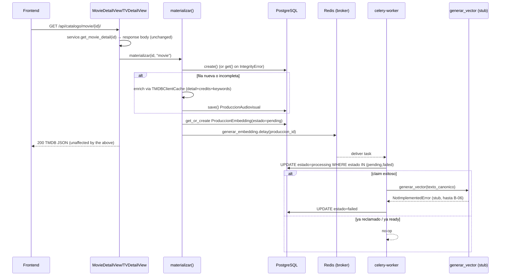

# Design: Catalog On-Demand Materialization + Embedding Enqueue (C-04a)

## Technical Approach

A service layer under `catalogo/services/` sits between the existing
`TMDBClientCache` singleton (`get_catalog_service()`, C-03) and a new
`ProduccionEmbedding` model. `materializar()` is the single entry point;
everything downstream of "row exists and is enriched" is delegated to a
Celery task whose only unfinished piece is the provider call itself
(`generar_vector`), isolated behind `catalogo/services/embeddings.py` so B-06
can swap it for a real Ollama client with no changes to `tasks.py`,
`materialization.py`, or the model.

## Architecture Decisions

| Decision | Options | Tradeoff | Choice |
|---|---|---|---|
| Cast/crew retrieval | Change `get_movie_detail`/`get_tv_detail` to `append_to_response=credits,keywords` · Add new `get_*_credits` methods | `append_to_response` cuts TMDB calls from 3→1 but mutates the response shape of two methods already covered by closed C-01/C-02 tests and consumed unchanged by C-03's passthrough contract. New methods are additive, zero risk to existing tests, cost 2 extra cached calls only on first materialization. | Additive `get_credits(id_tmdb, tipo)` on `TMDBClient` + `TMDBClientCache` |
| Enrichment timing | Synchronous in `materializar()` · Deferred to the Celery task | The embedding's canonical text needs Title+Genres+Directors+Cast+Keywords+Synopsis *before* it is queued, and TMDB calls are Redis-cached (24h), so sync cost is bounded. Deferring would need the task to re-derive enrichment, duplicating logic and re-opening the "no external calls in the task without a claim" concern. | Enrichment stays synchronous inside `materializar()`, gated by a completeness check so rows created incomplete elsewhere (future C-04b bulk sync) get repaired on next open |
| Package for `VectorField` | `pgvector` (pgvector-python, ships `pgvector.django`) · `django-pgvector` (named in `docs/05_Plan_de_Desarrollo.md`/`decisiones.md`) | `django-pgvector` is not the maintained package for this; `pgvector`'s own `pgvector.django` submodule provides `VectorField`, `HnswIndex`, `VectorExtension` and is what the ecosystem uses with Django 5.x. | `pgvector` only; correct the docs (see Documentation Updates) |
| `db` image swap risk | Recreate `pgdata` volume · Swap image in place | **Corrected 14/09/2026:** pgvector publishes no Alpine variant (the `pg16-alpine` tag assumed here does not exist), so the image is Debian-based. Moving musl → glibc changes text collation, which affects index ordering, so reusing the volume risks silently mis-ordered text indexes. | `pgvector/pgvector:pg16` (Debian) + **recreate** `pgdata`. Cost is nil in dev (the entrypoint re-runs migrations and recreates the superuser). Team action: `docker compose down && docker volume rm filmai_pgdata && docker compose up --build -d` |
| Claim/lease mechanism | Dedicated lease/expiry column · Plain conditional `UPDATE ... WHERE estado IN (...)` | A full lease-with-expiry (for reclaiming stuck `processing` rows) is backfill/C-04b's job. C-04a only needs to prevent double-processing from duplicate Celery deliveries. | Conditional `.filter(estado__in=[PENDING, FAILED]).update(estado=PROCESSING)`; `fecha_actualizacion` is left as the hook C-04b's backfill will use to detect stale `processing` rows |
| Detail-view wiring | Call `materializar()` from `MovieDetailView`/`TVDetailView` · Leave wiring for a later task | CU-021 requires "any production opened in detail is materialized"; nothing else in the current codebase calls the helper yet (Listas doesn't exist, frontend detail pages don't exist). Not wiring it makes C-04a dead code. Confirmed with repo owner 14/09/2026. | Views call `materializar()` as a side effect; response body is untouched (still raw TMDB JSON passthrough per C-03) |
| Concurrency test technique | Real `TransactionTestCase` + threads · Deterministic mocked `IntegrityError` | Real thread-based races against Postgres are valuable but flaky across CI environments (connection sharing, GIL timing) — a good PR could get blocked by test timing, not a real bug. Confirmed with repo owner 14/09/2026. | Required test: mock `ProduccionAudiovisual.objects.create` to raise `IntegrityError`, assert fallback to `.get()` returns the existing row. Optional/best-effort: a `TransactionTestCase` with a `threading.Barrier` for real-DB confidence, not a merge gate |

## Data Model: `ProduccionEmbedding`

```python
class EstadoEmbedding(models.TextChoices):
    PENDING = "pending", "Pendiente"
    PROCESSING = "processing", "Procesando"
    READY = "ready", "Listo"
    FAILED = "failed", "Falló"


class ProduccionEmbedding(models.Model):
    produccion = models.OneToOneField(
        ProduccionAudiovisual,
        on_delete=models.CASCADE,
        related_name="embedding",
        verbose_name="producción audiovisual",
    )
    vector = VectorField(
        "vector semántico",
        dimensions=1024,
        null=True,
        blank=True,
        help_text="Generado por el proveedor de embeddings (Ollama/bge-m3, "
        "stub hasta B-06). Nulo mientras el estado no es 'ready'.",
    )
    estado = models.CharField(
        "estado", max_length=20, choices=EstadoEmbedding.choices,
        default=EstadoEmbedding.PENDING,
    )
    source_hash = models.CharField("hash del texto fuente", max_length=64, blank=True, default="")
    model_version = models.CharField("versión del modelo", max_length=50, blank=True, default="")
    fecha_creacion = models.DateTimeField("fecha de creación", auto_now_add=True)
    fecha_actualizacion = models.DateTimeField("fecha de actualización", auto_now=True)

    class Meta:
        db_table = "produccion_embedding"
        verbose_name = "embedding de producción"
        verbose_name_plural = "embeddings de producción"
        indexes = [
            models.Index(fields=["estado"], name="idx_embedding_estado"),
            HnswIndex(
                name="idx_embedding_vector_hnsw",
                fields=["vector"],
                m=16,
                ef_construction=64,
                opclasses=["vector_cosine_ops"],
            ),
        ]
        constraints = [
            models.CheckConstraint(
                check=~models.Q(estado=EstadoEmbedding.READY) | models.Q(vector__isnull=False),
                name="ck_embedding_ready_requiere_vector",
            ),
        ]
```

`OneToOneField` already enforces `produccion_id` UNIQUE at the DB level — no
extra `UniqueConstraint` needed (matches decisiones.md's "no una FK común").
Migration:

```python
from pgvector.django import VectorExtension

class Migration(migrations.Migration):
    operations = [
        VectorExtension(),
        migrations.CreateModel(name="ProduccionEmbedding", fields=[...]),
        migrations.AddIndex(...),
        migrations.AddConstraint(...),
    ]
```

`VectorExtension()` runs `CREATE EXTENSION IF NOT EXISTS vector;` and requires
the `db` service to already be `pgvector/pgvector:pg16`. Verified 14/09/2026:
the extension is available (v0.8.6) and the dev Postgres role has
`rolsuper = true`, so `CREATE EXTENSION` succeeds.

## TMDB Enrichment Mapping

New additive client method (no changes to existing `get_movie_detail`/`get_tv_detail`).

**Implemented (14/09/2026) as a single `get_credits(id_tmdb, tipo)`**, not the
two methods originally sketched here: the credits URL has the same shape as
keywords (`/{tipo}/{id}/credits` vs `/{tipo}/{id}/keywords`), so it follows the
existing `get_keywords(id_tmdb, tipo)` signature instead of mirroring the
detail methods. One method less and consistent with its neighbour.

```python
# client.py
def get_credits(self, id_tmdb, tipo):
    return self._get(f"/{tipo}/{id_tmdb}/credits")
```

```python
# cache.py — ENDPOINT_TTLS gains "credits": 24*3600
def get_credits(self, id_tmdb, tipo):
    params = {"id_tmdb": id_tmdb, "tipo": tipo}
    return self._cached_call(
        "credits", params, lambda: self.client.get_credits(id_tmdb, tipo)
    )
```

Field mapping in `materialization.py` (pure function, unit-testable without DB):

| `ProduccionAudiovisual` field | Movie source | TV source |
|---|---|---|
| `titulo` | `detalle["title"]` | `detalle["name"]` |
| `poster` | `detalle["poster_path"]` (raw TMDB path, same convention as C-03 passthrough — the frontend builds the CDN URL) | same |
| `sinopsis` | `detalle["overview"]` | same |
| `fecha_lanzamiento` | `detalle["release_date"]` or `None` if empty | `detalle["first_air_date"]` or `None` |
| `reparto` | `[c["name"] for c in credits["cast"][:10]]` | same, from `/tv/{id}/credits` |
| `directores` | `[c["name"] for c in credits["crew"] if c["job"] == "Director"]` | same |
| `estatus` | `detalle["status"]` | same |
| `generos` | `[g["name"] for g in detalle["genres"]]` | same |
| `keywords` | `keywords_payload["keywords"]` — **note the key differs by type** | `keywords_payload["results"]` |
| `calificacion_promedio` | `detalle["vote_average"]` | same |
| `cantidad_temporadas` | `None` | `detalle["number_of_seasons"]` |
| `cantidad_episodios` | `None` | `detalle["number_of_episodes"]` |
| `duracion` | `detalle["runtime"]` | `detalle["episode_run_time"][0]` if non-empty else `None` |

`materializar()` treats a row as needing enrichment if `not produccion.titulo`
(covers both a brand-new row and any incomplete row created elsewhere, e.g. a
future C-04b bulk `update_or_create` from list summaries).

## Embedding Text + Stub Provider (`catalogo/services/embeddings.py`)

```python
MODEL_VERSION = "stub-v1"  # placeholder; B-06 replaces with the real Ollama/bge-m3 identifier


def construir_texto_canonico(produccion) -> str:
    partes = {
        "Title": produccion.titulo.strip(),
        "Genres": ", ".join(sorted(g.strip() for g in produccion.generos if g.strip())),
        "Directors": ", ".join(sorted(d.strip() for d in produccion.directores if d.strip())),
        "Cast": ", ".join(sorted(r.strip() for r in produccion.reparto if r.strip())),
        "Keywords": ", ".join(sorted(k.strip() for k in produccion.keywords if k.strip())),
        "Synopsis": (produccion.sinopsis or "").strip(),
    }
    return "\n".join(f"{label}: {value}" for label, value in partes.items())


def calcular_source_hash(texto: str) -> str:
    return hashlib.sha256(texto.encode("utf-8")).hexdigest()


class EmbeddingProviderError(Exception):
    """El proveedor de embeddings no pudo generar el vector."""


def generar_vector(texto: str) -> list[float]:
    """Punto de extensión para B-06 (Marcos): reemplazar por el cliente real
    de Ollama/bge-m3. Sin proveedor conectado hoy, siempre falla — la tarea
    Celery captura esto y deja el embedding en estado 'failed' (criterio de
    aceptación de C-04a)."""
    raise NotImplementedError(
        "generar_vector: proveedor de embeddings no implementado (B-06)."
    )
```

Sorting each array before joining normalizes TMDB's non-deterministic
ordering across repeated fetches, so `source_hash` only changes when content
actually changes (decisiones.md: "normalizado ... orden de arrays").

## Celery Task (`catalogo/tasks.py`)

```python
@shared_task(name="catalogo.generar_embedding")
def generar_embedding(produccion_id: int) -> None:
    try:
        embedding = ProduccionEmbedding.objects.select_related("produccion").get(
            produccion_id=produccion_id
        )
    except ProduccionEmbedding.DoesNotExist:
        logger.warning("generar_embedding: sin fila para produccion_id=%s", produccion_id)
        return

    texto = construir_texto_canonico(embedding.produccion)
    source_hash = calcular_source_hash(texto)

    if (embedding.estado == EstadoEmbedding.READY
            and embedding.source_hash == source_hash
            and embedding.model_version == MODEL_VERSION):
        return  # idempotencia fuerte: nada cambió

    claimed = ProduccionEmbedding.objects.filter(
        produccion_id=produccion_id,
        estado__in=[EstadoEmbedding.PENDING, EstadoEmbedding.FAILED],
    ).update(estado=EstadoEmbedding.PROCESSING)
    if claimed == 0:
        return  # ya reclamado por otra ejecución, o ya ready con otro hash pendiente de repaso

    try:
        vector = generar_vector(texto)
        if vector is None:
            raise EmbeddingProviderError("El proveedor devolvió None")
    except Exception:
        logger.exception("generar_embedding: proveedor falló produccion_id=%s", produccion_id)
        ProduccionEmbedding.objects.filter(produccion_id=produccion_id).update(
            estado=EstadoEmbedding.FAILED
        )
        return

    ProduccionEmbedding.objects.filter(produccion_id=produccion_id).update(
        vector=vector, estado=EstadoEmbedding.READY,
        source_hash=source_hash, model_version=MODEL_VERSION,
    )
```

No `transaction.atomic()` wraps the provider call — each state transition is
its own `.update()`, matching "nunca mantener transacciones abiertas durante
la llamada al proveedor" (decisiones.md, 08/09/2026). `except Exception`
(broad) is deliberate here: this is the boundary between "our code" and an
unimplemented/unreliable external stub, and any failure — including the
expected `NotImplementedError` — must land in `failed`, never crash the
worker.

## Sequence Diagram



## Celery Configuration

```python
# backend/filmai/celery.py
import os
from celery import Celery

os.environ.setdefault("DJANGO_SETTINGS_MODULE", "filmai.settings")

app = Celery("filmai")
app.config_from_object("django.conf:settings", namespace="CELERY")
app.autodiscover_tasks()
```

```python
# backend/filmai/__init__.py
from .celery import app as celery_app

__all__ = ("celery_app",)
```

```python
# settings.py additions
CELERY_BROKER_URL = config("CELERY_BROKER_URL", default="redis://redis:6379/1")
CELERY_RESULT_BACKEND = config("CELERY_RESULT_BACKEND", default="redis://redis:6379/2")
CELERY_TASK_SERIALIZER = "json"
CELERY_RESULT_SERIALIZER = "json"
CELERY_ACCEPT_CONTENT = ["json"]
```

Separate logical Redis DBs (`/0` cache+Django cache, `/1` broker, `/2`
results) avoid key collisions with `TMDBClientCache`/`CACHES["default"]`,
which stay on `REDIS_URL` (`/0`).

## Docker Compose Changes

```yaml
db:
  image: pgvector/pgvector:pg16   # was postgres:16-alpine

celery-worker:
  build:
    context: ./backend
    dockerfile: Dockerfile
  container_name: filmai_celery_worker
  restart: unless-stopped
  user: "${UID:-1000}:${GID:-1000}"
  command: celery -A filmai worker -l info
  env_file:
    - .env
  volumes:
    - ./backend:/app
  depends_on:
    db:
      condition: service_healthy
    redis:
      condition: service_healthy
  networks:
    - filmai_network
```

No `celery-beat` here — scheduled tasks (`sync_catalogo_diaria`, backfill)
belong to C-04b.

## `.env.example` Additions

```
# Celery — cola de tareas asincrónicas (embeddings, C-04a)
CELERY_BROKER_URL=redis://redis:6379/1                                       # [fijo] DB Redis separada del caché TMDB (DB 0)
CELERY_RESULT_BACKEND=redis://redis:6379/2                                   # [fijo] DB Redis separada
```

`OLLAMA_BASE_URL`/`EMBEDDING_MODEL`/`EMBEDDING_DIM` are explicitly NOT added
here — they belong to B-06 when the real `ollama` service lands.

## Documentation Updates

- `README.md`: 4→5 service topology; drop "(planificada)" for
  `ProduccionEmbedding`, note the provider is stubbed.
- `docs/decisiones.md`: new entry (14/09/2026) recording: (1) advancing
  minimal embedding infra (model + Celery + pgvector image) inside C-04a
  while the provider stays stubbed for B-06; (2) the `get_credits(id_tmdb, tipo)` addition and why detail endpoints alone were insufficient;
  (3) the `pgvector` vs `django-pgvector` package correction; (4) `poster`
  stores the raw TMDB `poster_path`, consistent with C-03's passthrough
  convention; (5) concurrency test strategy (mock required, real threads
  best-effort).

## Testing Strategy

| Layer | What | Approach |
|---|---|---|
| Unit | adapter | `tmdb_a_dominio`/`dominio_a_tmdb` round-trip + `ValueError` on unknown values |
| Unit | canonical text/hash | array sorting normalizes order; empty fields don't crash; hash stable across equal inputs, changes on content diff |
| Unit | model constraints | `OneToOneField` uniqueness; `ck_embedding_ready_requiere_vector` rejects `ready` + `vector=None` |
| Unit | materialization race | mock `.create()` → `IntegrityError` → assert `.get()` fallback returns the same row, no exception raised |
| Integration | materialization enrichment | mock `get_catalog_service()` (detail+credits+keywords fixtures) → assert all mapped fields + `ProduccionEmbedding(pending)` created + `generar_embedding.delay` called once with the right id |
| Unit | task claim/idempotency | `estado=ready` + same hash/version → no `.update()` call happens (mock provider, assert not called); `estado=pending` → claimed, provider mocked to succeed → `ready` + hash/version stored |
| Unit | task failure | provider mocked/raising (or the real `NotImplementedError` stub) → `estado=failed`, production row untouched/still visible |
| Unit | task concurrent claim | two calls to `generar_embedding` when already `processing` → second is a no-op (`claimed == 0`) |
| Integration | view wiring | `APIClient` GET on movie/tv detail → response body unchanged (still TMDB passthrough) + `ProduccionAudiovisual` row exists in DB after the call |
| Best-effort | real concurrency | `TransactionTestCase` + `threading.Barrier`, two threads calling `materializar()` for the same `(id_tmdb, tipo)` → exactly one row; documented as non-blocking if flaky |

## Threat Matrix

N/A — no shell/subprocess/VCS automation. Celery task execution is in-process
Python invoked by the worker process, not shell dispatch.

## Migration / Rollout

`VectorExtension()` requires the `db` service already running
`pgvector/pgvector:pg16` before `python manage.py migrate` — sequence
these in PR1→PR2 (see tasks.md). No destructive volume operation; verify with
`docker compose exec db psql -U $POSTGRES_USER -d $POSTGRES_DB -c "\dx"`
before/after in dev to confirm data survives the image swap.

## Open Questions

- Confirm the dev Postgres role has `CREATE EXTENSION` privilege (default
  superuser role from `docker-compose.yml` env vars should, but verify before
  PR2's migration).
