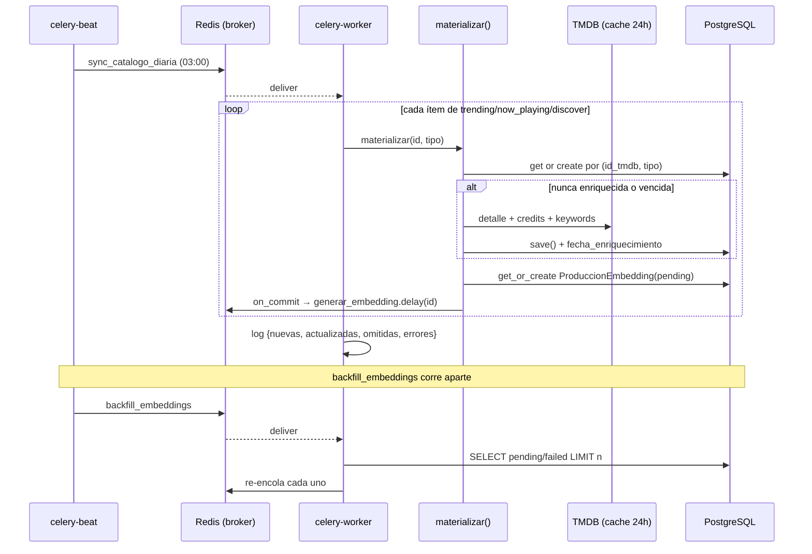

# Design: Daily Catalog Sync + Embedding Backfill (C-04b)

## Technical Approach

Two Celery tasks and one scheduler. `sync_catalogo_diaria()` walks the three
listing endpoints and delegates every write to `materializar()`;
`backfill_embeddings()` re-enqueues embedding work that never completed. A
`celery-beat` service fires the first one nightly.

Nothing here writes to `ProduccionAudiovisual` directly. That constraint is not
stylistic: it is the guarantee the `catalog-materialization` spec makes, and it
is what keeps the enrichment mapping — with all its TMDB type asymmetries — in
exactly one place.

## Architecture Decisions

| Decision | Alternatives | Rationale | Outcome |
|---|---|---|---|
| Sync writes through `materializar()` | Direct `update_or_create` (as the 08/09 plan said) · `materializar()` taking a pre-fetched payload | The canonical spec requires exactly one write path. A listing item lacks `genres`, `status`, `runtime`, cast, crew and keywords — four of the six canonical-text sections — so writing from it produces rows that are permanently mutilated. Passing the pre-fetched item saves only the detail call while still needing credits and keywords, and it splits the function into two modes to test. | The sync iterates and calls `materializar(item["id"], tipo)` |
| Completeness recorded, not inferred | Keep `not titulo` · Use empty `estatus` as a sentinel | Both alternatives *infer* a fact from a side effect, and that is exactly what broke: `not titulo` only worked while a single writer filled every column at once, and nothing declared that coincidence, so nothing warned when the sync was about to break it. `estatus` is a more reliable sentinel — only the detail endpoint returns it — but it is still an inference, and it carries no age. Recording the fact removes the guesswork. | New nullable `fecha_enriquecimiento` `DateTimeField`, set on every successful enrichment |
| Staleness asks TMDB, it does not guess | A fixed refresh window (30 days) alone | A time window refreshes rows whether or not anything changed: over a 10k corpus a 30-day window re-pulls ~333 rows a night, most of them identical to what we already hold. TMDB publishes `/movie/changes` and `/tv/changes` — the ids modified in the last 24 h (confirmed live 15/09/2026: 7 351 movies, 74 pages). Intersecting that set with our own ids refreshes exactly what moved, and is cheaper than the sweep it replaces. | Three layers: `NULL` ⇒ enrich · id in today's changes ⇒ refresh · untouched beyond a long safety window ⇒ refresh |
| Explicit `forzar` flag on `materializar()` | A separate `re_enriquecer()` helper · Sync mutates `fecha_enriquecimiento` to force the path | A second helper re-opens the two-write-paths problem. Having the caller blank a field to trigger behavior is action at a distance. A flag keeps the decision at the call site and the mechanism in one function. | `materializar(id_tmdb, tipo_tmdb, forzar=False)` |
| Backfill processes bounded batches | Enqueue every `pending`/`failed` row per run | With a 10k-row corpus (C-04c), one run would push 10k messages into Redis at once and starve interactive work. A cap per run is one parameter and lets the next run continue. | `backfill_embeddings(limite=...)` with a conservative default |
| Timezone declared explicitly | Rely on the container default | "3 AM" is meaningless without a zone. The failure is silent and surfaces months later as "the sync runs at the wrong time". | `CELERY_TIMEZONE` set and recorded in `docs/decisiones.md` |
| Enqueue inside `transaction.on_commit()` | Keep the direct `.delay()` | Identical today (no open transaction ⇒ it runs immediately), and it protects the moment anything wraps materialization in `atomic()` — which batching is a natural candidate for. A worker must never receive an id for a row that is not yet visible. | `transaction.on_commit(lambda: generar_embedding.delay(...))` |

## Why a listing item is not enough

Confirmed against the live API on 15/09/2026. A `trending` item carries:

```
adult · backdrop_path · genre_ids · id · media_type · original_language
original_title · overview · popularity · poster_path · release_date
title · video · vote_average · vote_count
```

Mapped against the model, that leaves:

| Field | From a listing item | From the detail endpoint |
|---|---|---|
| `titulo`, `sinopsis`, `poster`, `fecha_lanzamiento`, `calificacion_promedio` | ✅ | ✅ |
| `generos` | ❌ only `genre_ids` (numeric) | ✅ names |
| `estatus`, `duracion` | ❌ absent | ✅ |
| `cantidad_temporadas`, `cantidad_episodios` | ❌ absent | ✅ |
| `reparto`, `directores` | ❌ absent | ✅ via `/credits` |
| `keywords` | ❌ absent | ✅ via `/keywords` |

Four of the six canonical-text sections — Genres, Directors, Cast, Keywords —
are unreachable from a listing. A row built from one would be embedded on a
mutilated text and, under the old `not titulo` criterion, would count as
complete forever. This is the single strongest argument for routing every write
through `materializar()`.

## Data Model Change

```python
# catalogo/models.py — ProduccionAudiovisual
fecha_enriquecimiento = models.DateTimeField(
    "fecha de enriquecimiento",
    null=True,
    blank=True,
    help_text="Cuándo se trajo por última vez el detalle completo de TMDB "
    "(detalle + créditos + keywords). Nulo significa que la fila nunca se "
    "enriqueció. La sync diaria (C-04b) refresca lo que TMDB reporta como "
    "cambiado; esta fecha es además la red de seguridad si esa lista se pierde.",
)
```

Nullable and additive, so the migration is safe on existing rows: the two rows
currently in dev were enriched, but leaving them `NULL` simply means the next
sync refreshes them, which is harmless and self-correcting.

## Materialization Changes

```python
_DIAS_RED_DE_SEGURIDAD = 90  # red de seguridad, no el mecanismo principal:
                             # lo que cambió de verdad lo dice /changes


def materializar(id_tmdb, tipo_tmdb, forzar=False):
    tipo = tmdb_a_dominio(tipo_tmdb)
    produccion = _obtener_o_crear(id_tmdb, tipo)

    if forzar or _necesita_enriquecimiento(produccion):
        _enriquecer(produccion, id_tmdb, tipo_tmdb)

    _encolar_embedding(produccion)
    return produccion


def _necesita_enriquecimiento(produccion):
    """Una fila necesita el detalle de TMDB si nunca lo vio, o si pasó muchísimo.

    Reemplaza el criterio de C-04a (`not titulo`), que no distinguía una fila
    completa de una creada desde un listado: un ítem de listado trae título
    pero no géneros, reparto, créditos ni keywords.

    Acá NO se decide si la fila quedó desactualizada: eso lo responde TMDB por
    su lista de cambios, y la sync lo fuerza con `forzar=True`. La ventana de
    abajo es solo una red de seguridad por si esa lista se pierde (la sync no
    corrió una noche, la API falló), no el mecanismo principal.
    """
    if produccion.fecha_enriquecimiento is None:
        return True
    return timezone.now() - produccion.fecha_enriquecimiento > timedelta(
        days=_DIAS_RED_DE_SEGURIDAD
    )
```

`_enriquecer()` sets `fecha_enriquecimiento = timezone.now()` alongside the
mapped fields, in the same `save()`.

## Freshness: three layers, one question each

Confirmed live on 15/09/2026: `GET /movie/changes` answers `200` with
`total_results: 7351` across 74 pages — every movie TMDB modified in the last
24 h. `/tv/changes` mirrors it. Each layer below answers a different question,
and none of them guesses:

| Layer | Question | Mechanism |
|---|---|---|
| Completeness | Was this row ever enriched? | `fecha_enriquecimiento is None` |
| Real change | Does TMDB say it changed? | membership in today's changes set |
| Safety net | Have we ignored it for far too long? | `_DIAS_RED_DE_SEGURIDAD` |

The middle layer is the one that does the real work. A fixed window alone would
re-pull ~333 rows a night over a 10k corpus regardless of whether anything
moved; the intersection refreshes only what actually did.

```python
# Tope defensivo: la lista de cambios ronda las 74 páginas por tipo, pero es
# una API externa y no queremos que un día raro convierta la sync en un
# rastreo sin fin.
_MAX_PAGINAS_CAMBIOS = 100


def _ids_cambiados(servicio, tipo_tmdb):
    """IDs que TMDB reporta como modificados en las últimas 24 h."""
    ids, pagina = set(), 1
    while pagina <= _MAX_PAGINAS_CAMBIOS:
        payload = servicio.get_changes(tipo_tmdb, pagina)
        ids.update(item["id"] for item in payload.get("results", []) if "id" in item)
        if pagina >= payload.get("total_pages", 1):
            break
        pagina += 1
    return ids
```

The intersection happens **in Python, not in SQL**. Our own ids come back as a
set and meet the changed set there:

```python
nuestros = set(
    ProduccionAudiovisual.objects.filter(tipo=tipo).values_list("id_tmdb", flat=True)
)
a_refrescar = nuestros & _ids_cambiados(servicio, tipo_tmdb)
```

Pushing 7 000 ids into an `id_tmdb__in=(...)` clause would build an enormous
query for no gain; a 10k-element set costs nothing in memory and the
intersection is instant. Each id in `a_refrescar` is then materialized with
`forzar=True`.

New client and cache method, following the shape the others already use:

```python
# client.py
def get_changes(self, tipo, page=1):
    return self._get(f"/{tipo}/changes", {"page": page})

# cache.py — ENDPOINT_TTLS gains "changes": 6 * 3600
```

A 6 h TTL is short because the list rolls daily, and long enough that a retried
task does not re-fetch 74 pages.

## Sync Task

```python
# Qué recorre cada corrida. Son tres páginas de ~20 ítems: suficiente para
# capturar novedades sin convertir la sync en un rastreo de todo TMDB, que es
# trabajo del seed (C-04c).
_FUENTES = (
    ("trending", lambda s: s.get_trending("all", "week", 1)),
    ("now_playing", lambda s: s.get_now_playing(1)),
    ("discover_movie", lambda s: s.discover("movie", page=1)),
    ("discover_tv", lambda s: s.discover("tv", page=1)),
)
```

Per item the task resolves the TMDB type — `media_type` when the endpoint
provides it (trending is mixed), otherwise the type implied by the endpoint —
and calls `materializar()`. Unknown types (`person` appears in trending) are
skipped: `tmdb_a_dominio` already raises `ValueError` for anything that is not
`movie` or `tv`, and that is the correct signal.

Failures are counted, logged and swallowed **per item**: one unavailable title
must not abort the run. This mirrors the failure policy the detail views use,
and for the same reason.

The run has **two passes**, and they do different jobs:

1. **Discovery** — walk `_FUENTES` and materialize each item. This is what
   grows the corpus without waiting for a user to click: it is the answer to
   the cold start, where semantic search can only surface what somebody already
   opened.
2. **Refresh** — intersect our own ids with TMDB's changes list and re-materialize
   that set with `forzar=True`. This is what keeps the copy honest as titles are
   released, seasons are added and ratings move.

Both passes go through `materializar()`, so neither can produce a partial row.

The run returns and logs a statistics dict: `nuevas`, `actualizadas`,
`omitidas`, `errores`.

## Backfill Task

```python
_RECUPERABLES = (EstadoEmbedding.PENDING, EstadoEmbedding.FAILED)


def backfill_embeddings(limite=100):
    """Re-encola el trabajo de embeddings que quedó sin completar."""
```

Two populations, in order:

1. `pending` / `failed` rows — including the one C-04a left open: an embedding
   stranded in `pending` because the broker was down when `.delay()` ran.
   `get_or_create` returns `creado=False` on later visits, so nothing else ever
   retries it.
2. `ready` rows whose recomputed `source_hash` or stored `model_version` no
   longer matches — the legitimate regeneration path, and exactly what will be
   needed the day B-06 changes `MODEL_VERSION`.

It re-enqueues rather than computing inline: `generar_embedding` already owns
the claim/lease logic, and duplicating it here would be a second source of
truth for idempotency.

## Sequence Diagram



## Docker Compose

A sixth service. It reuses the backend image and, like the worker, sets
`RUN_MIGRATIONS: "false"` so only one container migrates.

```yaml
  celery-beat:
    build: ./backend
    env_file: [.env]
    environment:
      RUN_MIGRATIONS: "false"
    command: celery -A filmai beat -l info
    depends_on:
      redis: { condition: service_healthy }
      db: { condition: service_healthy }
```

**Exactly one beat container.** Two schedulers means every task fires twice.
The tasks are idempotent so nothing corrupts, but it doubles TMDB traffic for
no reason.

## Testing Strategy

| Layer | Target | Approach |
|---|---|---|
| Unit | `_necesita_enriquecimiento` | `NULL` ⇒ true; recent ⇒ false; older than the window ⇒ true. No database needed |
| Unit | `materializar(forzar=True)` | Re-enriches a row that the criterion would have skipped |
| Unit | `_ids_cambiados` | Paginates until `total_pages`; stops at `_MAX_PAGINAS_CAMBIOS`; tolerates malformed entries |
| Integration | Refresh pass | A row whose id appears in the changes list is re-enriched; one that does not appear is left untouched even though it is complete |
| Integration | `sync_catalogo_diaria` | Mocked service returning listing fixtures; asserts one `materializar` call per item, `person` entries skipped, statistics correct |
| Integration | User data survives | Rate and review a production, run the sync, assert both intact — the acceptance criterion, tested directly |
| Integration | `backfill_embeddings` | `pending`/`failed` re-enqueued; `ready` with a matching hash untouched; `ready` with a changed hash re-enqueued; `limite` respected |
| Integration | `on_commit` | The two C-04a tests move to `captureOnCommitCallbacks(execute=True)` |
| Live | Everything | **Contrast the listing fixtures against the real API before closing.** In C-04a a fabricated `job: "Director"` in a fixture kept 172 tests green while, in production, no series had a director |

## Migration / Rollout

The migration is additive and nullable, so it applies to a populated database
without a backfill step. Existing rows keep `fecha_enriquecimiento = NULL`,
which the next sync interprets as "never enriched" and repairs.

Order matters for the work units: the `on_commit` change touches tests that
already exist, so it lands first and alone, where a regression is unambiguous.

## Open Questions

None blocking. Five decisions were resolved with the repo owner on 15/09/2026
(write path, completeness recorded rather than inferred, staleness from TMDB's
own changes list, seed split, `on_commit`) and are recorded in
`docs/decisiones.md`.

Deferred by design: `_DIAS_RED_DE_SEGURIDAD = 90` is a guess, but a much less
consequential one than the 30-day window it replaced — it only fires when the
changes list was missed, so being wrong costs a few redundant refreshes rather
than shaping the whole refresh strategy. Revisit once the corpus is real
(C-04c).

Worth measuring once the corpus exists: how large the daily intersection
actually is. If it turns out that a meaningful share of a 10k corpus changes
every night, the per-run cost of the sync grows and may need its own cap.
